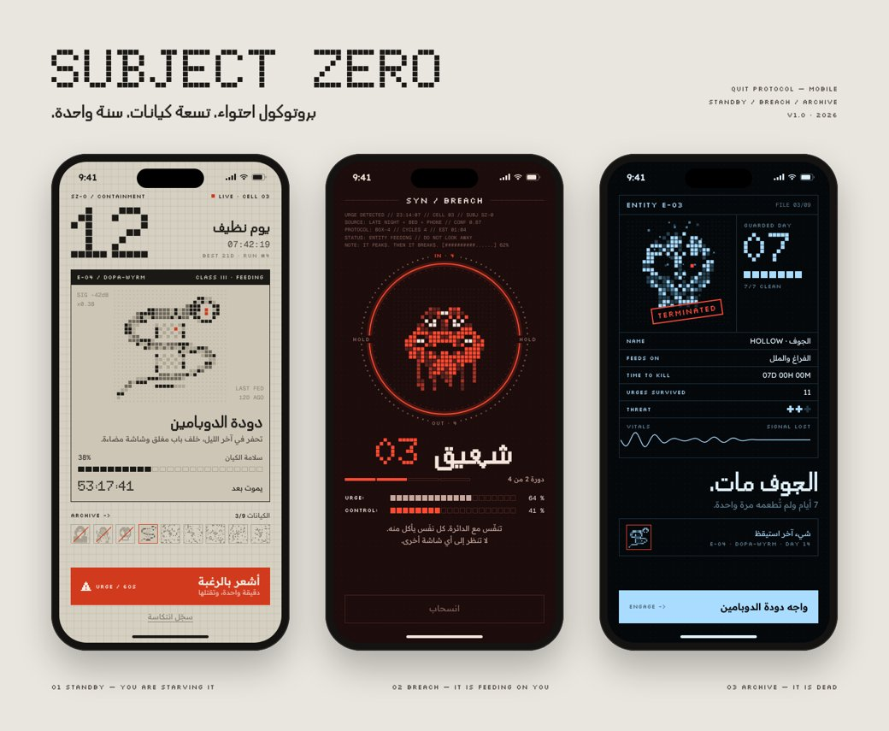

# Design — SUBJECT ZERO



تصميم Figma: https://www.figma.com/design/V3JdQrMKNx2rRXzmn6iWbH

سبع شاشات + صفحة الغلاف + صفحة النظام (الألوان، الخطوط، الكيانات التسعة، المكوّنات).
ثلاثة أوضاع: **STANDBY** (ورق بيج — أنت تُجوّعه)، **BREACH** (أحمر داكن — هو يتغذّى عليك)، **ARCHIVE** (أسود جليدي — ملفات الكيانات الميتة).

## Pipeline

The screens are authored as HTML (`gen.mjs`), the monsters are signed-distance shapes rasterised onto an LCD grid (`sprites.mjs`).
`ser.mjs` measures the rendered page in Chromium and writes a compact layer spec per frame; `compose.mjs` wraps each spec with
`builder.js` into a Figma Plugin API script (run through the Figma MCP `use_figma` tool), so every frame lands as editable layers.

```sh
node fetchfonts.mjs   # Doto, Silkscreen, Handjet, Readex Pro, Geist Mono -> fonts/fonts.css
node gen.mjs          # -> board.html
node glyphs.mjs       # lists characters a font cannot draw ({} = all good)
node shot.mjs         # PNG per screen and board
node ser.mjs          # -> specs/*.json
node compose.mjs      # -> call1.js … call5.js (screens first; the cover clones them)
```
